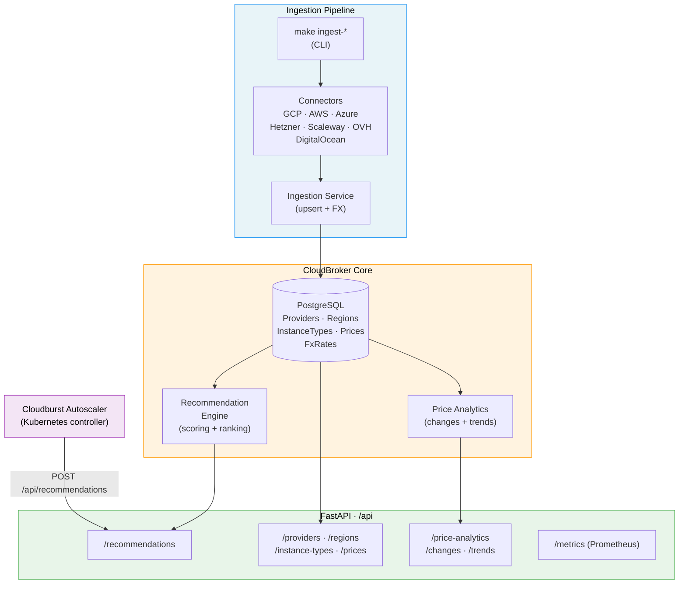

<p align="center">
  
</p>

<h1 align="center">CloudBroker</h1>

<p align="center">
  Multi-cloud compute pricing marketplace &mdash; ingests instance data from 7 providers, normalises prices to EUR, and exposes a recommendation engine that returns the cheapest instances matching a set of constraints.
</p>

## Architecture



### How it works

1. **Ingest** &mdash; CLI connectors pull instance types and hourly prices from each provider's API, convert to EUR, and upsert into PostgreSQL.
2. **Recommend** &mdash; Given constraints (CPU, RAM, arch, region, price ceiling, allowed providers), the engine filters candidates, scores them by price efficiency and resource fit, and returns a ranked list.
3. **Analyse** &mdash; Price-analytics endpoints detect changes and trends across the stored price history.
4. **Integrate** &mdash; [Cloudburst Autoscaler](https://github.com/braghettos/cloudburst-autoscaler) calls `POST /api/recommendations` to decide which VM to provision when Kubernetes pods are unschedulable.

## Features

- **7 cloud providers** &mdash; GCP, AWS, Azure, Hetzner, Scaleway, OVH, DigitalOcean
- **EUR-normalised pricing** &mdash; all prices converted via FX rates
- **Dual scoring modes** &mdash; legacy (price + fit) or multi-criteria (cost, performance, reliability)
- **Transparent ranking** &mdash; every recommendation includes an `explain` block
- **Price analytics** &mdash; change detection and trend analysis over historical data
- **Prometheus metrics** &mdash; `/api/metrics` endpoint
- **Idempotent ingestion** &mdash; safe to re-run at any time

## Tech Stack

| Layer | Technology |
|-------|-----------|
| API framework | FastAPI |
| ORM | SQLAlchemy 2.x (async via asyncpg) |
| Database | PostgreSQL 16 |
| Migrations | Alembic |
| Validation | Pydantic v2 |
| Rate limiting | SlowAPI |
| Metrics | prometheus-client |
| Logging | structlog |
| Containerisation | Docker + docker-compose |
| CI | GitHub Actions (lint, test, Docker build + push to GHCR) |

## Quick Start

### Docker (recommended)

```bash
cd cloudbroker
cp .env.example .env

# Start API + PostgreSQL
make up

# Run migrations
make migrate

# API is at http://localhost:8000
# Swagger UI at http://localhost:8000/docs
```

If you don't have a local Python env, run inside the container:

```bash
docker compose exec api alembic upgrade head
```

### Local

```bash
python3 -m venv .venv && source .venv/bin/activate
make install
cp .env.example .env
# Start PostgreSQL (e.g. docker compose up -d db)
make migrate
make dev
```

## Project Structure

```
app/
  main.py              # FastAPI application
  api/                 # Route handlers
  core/                # Config, database, logging, security, middleware
  models/              # SQLAlchemy models
  schemas/             # Pydantic schemas
  services/            # Business logic (recommendations, ingestion, analytics)
apps/
  ingestor/            # CLI for provider data ingestion
connectors/            # Provider-specific pricing connectors
migrations/            # Alembic migrations
scripts/               # Seed and utility scripts
tests/                 # Pytest test suite
docs/                  # Additional documentation
docker-compose.yml
Makefile
```

## Configuration

### Environment Variables

See `.env.example`. Key variables:

| Variable | Required | Description |
|----------|----------|-------------|
| `DATABASE_URL` | Yes | Async URL (`postgresql+asyncpg://...`) |
| `DATABASE_URL_SYNC` | Yes | Sync URL for Alembic (`postgresql://...`) |
| `APP_ENV` | No | `development` / `production` (default: `development`) |
| `API_KEY` | No | API key for auth (bypassed in dev mode) |
| `DEBUG` | No | Enable debug mode |

## Makefile Commands

Run `make help` for the full list. Key targets:

| Command | Description |
|---------|-------------|
| `make up` | Start stack (docker compose up -d) |
| `make down` | Stop stack |
| `make migrate` | Run Alembic migrations (upgrade head) |
| `make install` | Install all dependencies (dev + ingest) |
| `make dev` | Run API with hot-reload |
| `make test` | Run pytest |
| `make lint` | Run ruff linter |
| `make ingest-all` | Ingest pricing from all providers |
| `make ingest-gcp` | Ingest GCP Billing Catalog |
| `make ingest-aws` | Ingest AWS EC2 pricing |
| `make ingest-scaleway` | Ingest Scaleway pricing |
| `make ingest-hetzner` | Ingest Hetzner pricing |
| `make clean` | Remove caches and build artifacts |

## API Examples

```bash
# Health check
curl -s http://localhost:8000/health

# List providers
curl -s "http://localhost:8000/api/providers?limit=5"

# List regions (filter by provider)
curl -s "http://localhost:8000/api/regions?provider=aws"

# List instance types (filter by specs)
curl -s "http://localhost:8000/api/instance-types?min_vcpu=2&min_ram_gb=4&arch=x86_64&limit=10"

# List prices (filter by provider and region)
curl -s "http://localhost:8000/api/prices?provider=aws&region=eu-west-1&limit=5"

# Get recommendations
curl -s -X POST http://localhost:8000/api/recommendations \
  -H "Content-Type: application/json" \
  -d '{
    "min_vcpu": 2,
    "min_ram_gb": 4,
    "arch": "x86_64",
    "region_constraint": "EU",
    "max_price_eur_per_hour": 0.2,
    "limit": 5
  }'
# Response (example):
# {
#   "recommendations": [
#     {
#       "instance_type_name": "cx23",
#       "provider_slug": "hetzner",
#       "region_slug": "fsn1",
#       "vcpu": 2,
#       "ram_gb": 4.0,
#       "score": 0.9898,
#       "explain": { "resource_fit": 1.0, "normalized_price": 0.9797, "region_is_eu": true }
#     }
#   ]
# }
```

## Documentation

- [Article series](docs/articles/) &mdash; four-part intro (problem and product, how it works, interface, scope and run)
- [Architecture](docs/architecture.md) &mdash; data model, recommendation engine, ingestion pipeline, and integration with Cloudburst
- [Usage Guide](USAGE_GUIDE.md) &mdash; API examples and workflows
- **Swagger UI**: http://localhost:8000/docs (when running)

## License

See [LICENSE](LICENSE).
